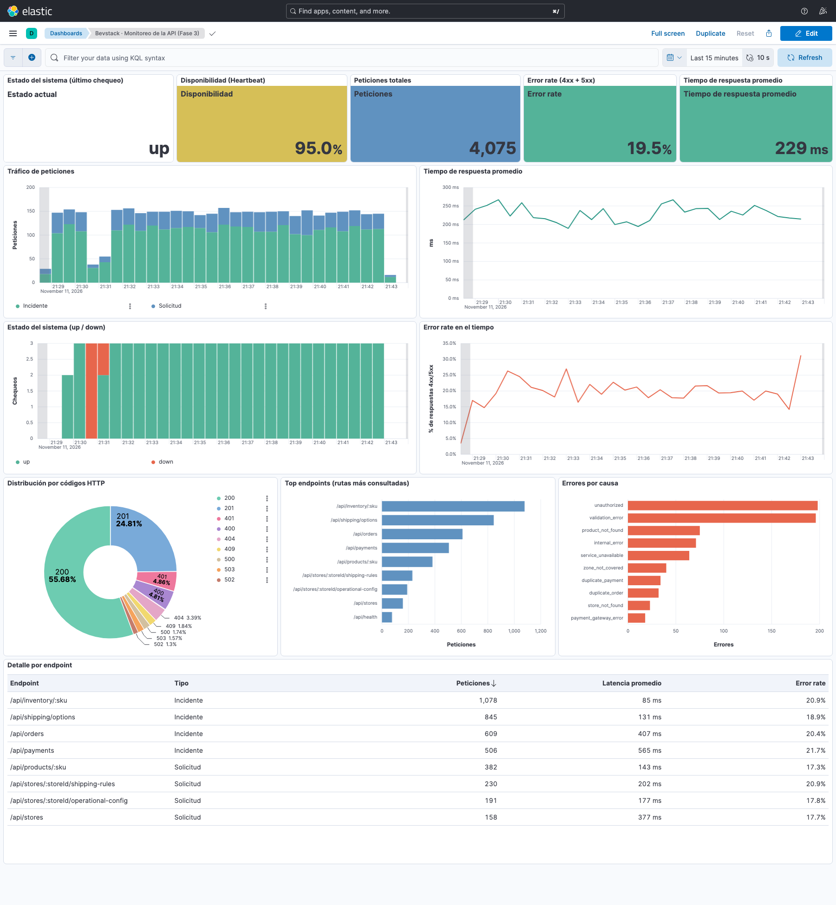

# Informe técnico · Fase 3: Monitoreo con ELK

**Servicio:** Operación de e-commerce para marcas en Bevstack
**Curso:** CC3047 · Administración y Mantenimiento de Sistemas · Universidad del Valle de Guatemala · Semestre II, 2026
**Catedrático:** Vinicio Paz
**Integrantes:** Julio García Salas · Sofía García · Joaquín Campos · Carlos Valladares

---

## 1. Objetivo

Construir un entorno de observabilidad básico con el stack ELK que permita al personal de soporte ver la salud del servicio definido en la Fase 1. El dashboard de Kibana se alimenta con logs reales generados automáticamente por la API del servicio y con un monitor de disponibilidad de Heartbeat.

Cada grupo debía visualizar en tiempo real tres aspectos:

- El comportamiento de las APIs.
- Las métricas de desempeño y salud.
- La disponibilidad y el tiempo de respuesta del servicio principal.

## 2. Servicio monitoreado y vía elegida

El servicio de la Fase 1 permite a las marcas operar sus ventas en línea mediante Bevstack: pedidos, pagos, inventario, disponibilidad de productos y reglas de envío. Su catálogo tiene ocho elementos, cuatro solicitudes y cuatro incidentes. El Service Desk web de la Fase 2 es el canal de atención, no el servicio que se monitorea.

Bevstack no cuenta con una API propia construida por el equipo, así que se tomó la vía de la **API simulada del servicio**. La API cumple las condiciones del enunciado:

| Condición del enunciado | Cómo se cumple |
|---|---|
| Un endpoint por cada elemento del catálogo de la Fase 1 | 8 endpoints, uno por elemento (sección 4.1). Una prueba automática verifica que coincidan con el catálogo. |
| Respuestas exitosas y errores 4xx y 5xx en una proporción definida y documentada | 80% éxito, 15% 4xx y 5% 5xx, configurable por variables de entorno (sección 4.2). |
| Tiempos de respuesta variables | Latencia aleatoria por endpoint, con picos lentos ocasionales. La API espera ese tiempo antes de responder (sección 4.2). |
| Logs generados automáticamente desde el código, con los campos indicados | Un middleware registra cada petición en `logs/api.log` (sección 4.3). |
| Generador de tráfico continuo | `scripts/traffic-generator.mjs` (sección 4.4). |

La simulación representa las dependencias descritas en la Fase 1 (sección 2.3, *Socios y proveedores*). Los errores 502 corresponden a fallas de proveedores externos: pasarela de pago (`payment_gateway_error`), transportista (`carrier_unavailable`), fulfillment (`fulfillment_unavailable`) y feed de inventario del retailer (`inventory_feed_error`). Así el dashboard permite distinguir si una falla está en Bevstack o en un proveedor, que es lo que la Fase 1 pide identificar antes de decidir la ruta de atención.

## 3. Arquitectura

```
                         ┌───────────────────────── docker compose (local) ─────────────────────────┐
                         │                                                                            │
  generador de tráfico ──┼─▶ API simulada ──escribe──▶ logs/api.log ──lee──▶ Filebeat ──▶ Elasticsearch ◀── Kibana :5601
  (traffic, ~5 req/s)    │   (api :4000)              (NDJSON · ECS)                       (:9200)          (dashboard)
                         │        ▲                                                           ▲            │
                         │        └──────── GET /api/health cada 10 s ──── Heartbeat ─────────┘            │
                         └────────────────────────────────────────────────────────────────────────────┘
```

| Componente | Tecnología | Función |
|---|---|---|
| API simulada | Node.js 22, sin dependencias (`node:http`) | Expone los 8 endpoints del catálogo y `/api/health`, y escribe un log JSON por petición. |
| Generador de tráfico | Node.js (`scripts/traffic-generator.mjs`) | Envía peticiones HTTP reales y continuas a la API. |
| Filebeat 8.19.5 | Input `filestream` + parser `ndjson` | Lee `logs/api.log` y envía cada línea a Elasticsearch. |
| Heartbeat 8.19.5 | Monitor `http` | Consulta `/api/health` cada 10 s y registra `up`/`down` y el tiempo de respuesta. |
| Elasticsearch 8.19.5 | Nodo único | Almacena los logs (`filebeat-*`) y los chequeos (`heartbeat-*`). |
| Kibana 8.19.5 | Lens + dashboards | Visualiza la salud del sistema. |

Se eligió Filebeat en lugar de Logstash porque los logs ya salen estructurados en formato ECS desde la API: no hace falta transformarlos, solo recolectarlos. Filebeat consume mucha menos memoria (unos 75 MB en la corrida, frente a los cientos que necesita Logstash) e instala por su cuenta la plantilla ECS en Elasticsearch.

## 4. Configuración

Todo el entorno se levanta con un comando: `docker compose up -d` (archivo `docker-compose.yml`). Los servicios arrancan en orden gracias a los *healthchecks*: Kibana, Filebeat y Heartbeat esperan a que Elasticsearch esté sano, y el generador espera a la API. Una tarea de un solo uso (`kibana-setup`) importa el dashboard en cuanto Kibana está disponible.

### 4.1 Endpoints

| Elemento del catálogo (Fase 1) | Tipo | Endpoint | Latencia base | Errores simulados |
|---|---|---|---|---|
| Activación de una nueva tienda | Solicitud | `POST /api/stores` | 120–450 ms | 400, 401, 409, 500, 502, 503 |
| Cambio en reglas de envío | Solicitud | `PUT /api/stores/:storeId/shipping-rules` | 80–250 ms | 400, 401, 404, 500, 503 |
| Actualización de configuración de productos | Solicitud | `PATCH /api/products/:sku` | 60–200 ms | 400, 401, 404, 500, 503 |
| Cambio de configuración operativa | Solicitud | `PUT /api/stores/:storeId/operational-config` | 70–220 ms | 400, 401, 404, 500, 503 |
| Pedido no procesado | Incidente | `POST /api/orders` | 150–600 ms | 400, 401, 409, 500, 502, 503 |
| Inventario incorrecto | Incidente | `GET /api/inventory/:sku` | 20–120 ms | 400, 401, 404, 500, 502, 503 |
| Pago completado sin creación del pedido | Incidente | `POST /api/payments` | 200–800 ms | 400, 401, 409, 500, 502, 503 |
| Opción de envío no disponible | Incidente | `GET /api/shipping/options` | 40–180 ms | 400, 401, 404, 500, 502, 503 |
| — (salud del servicio) | — | `GET /api/health` | inmediata | — |

### 4.2 Proporción de errores y latencia

En cada petición a un endpoint del catálogo, el simulador (`api/simulation.mjs`) decide dos cosas:

1. **Resultado:** 5% de probabilidad de error 5xx (`SERVER_ERROR_RATE=0.05`), 15% de error 4xx (`CLIENT_ERROR_RATE=0.15`) y 80% de éxito. El código concreto se elige entre los errores posibles del endpoint.
2. **Latencia:** un valor uniforme dentro del rango base del endpoint. El 5% de las peticiones es lento (×4), con tope de 3000 ms. La API espera ese tiempo antes de responder, así que la duración registrada es real.

Las proporciones se pueden cambiar sin tocar código. Por ejemplo, `SERVER_ERROR_RATE=0.4 docker compose up -d api` simula un incidente. Una prueba automática verifica, sobre 20 000 decisiones, que la proporción obtenida queda a menos de un punto porcentual de la configurada.

### 4.3 Logs de la API

Un middleware de `api/app.mjs` registra cada petición, sea exitosa, de error o una excepción, con una línea JSON en `logs/api.log`. Los campos siguen Elastic Common Schema (ECS):

| Campo requerido | Valor en el log |
|---|---|
| `@timestamp` | Momento de llegada de la petición (ISO 8601, UTC). |
| `http.request.method` | `GET`, `POST`, `PUT`, `PATCH`, … |
| `http.response.status_code` | Código HTTP devuelto (número). |
| `event.duration` | Duración en nanosegundos, como define ECS. |
| `url.path` | Ruta real, por ejemplo `/api/inventory/SKU-618`. |
| `service.name` | `bevstack-ecommerce-api`. |
| `log.level` | `info` (2xx), `warn` (4xx) o `error` (5xx). |

Además se agregan campos que hacen el dashboard más útil para soporte:

- `labels.route`: plantilla de la ruta, por ejemplo `/api/inventory/:sku`, para agrupar el top de endpoints.
- `labels.catalog_item` y `labels.catalog_type`: el elemento del catálogo y si es Incidente o Solicitud, como en la Fase 1.
- `error.code` y `error.message` en cada fallo.
- `event.outcome`: `success` o `failure`.

Ejemplo real (502 por falla del feed de inventario):

```json
{"@timestamp":"2026-11-12T03:10:38.834Z","log":{"level":"error","logger":"http"},"message":"GET /api/inventory/SKU-502 502 inventory_feed_error","ecs":{"version":"8.11.0"},"service":{"name":"bevstack-ecommerce-api","environment":"local"},"event":{"kind":"event","category":["web"],"type":["access"],"outcome":"failure","duration":54712916},"http":{"request":{"method":"GET"},"response":{"status_code":502}},"url":{"path":"/api/inventory/SKU-502"},"labels":{"route":"/api/inventory/:sku","catalog_item":"incorrect-inventory","catalog_type":"Incidente"},"error":{"code":"inventory_feed_error","message":"El feed de inventario del retailer falló."}}
```

La muestra entregable `logs/sample-api.log` tiene **205 registros** generados por la API real con `pnpm logs:sample`.

### 4.4 Generador de tráfico

`scripts/traffic-generator.mjs` corre como el servicio `traffic` del compose, o con `pnpm traffic` en local. Envía peticiones de forma continua, a unas 5 por segundo con una variación de ±50% entre peticiones, para que el tráfico tenga ráfagas. Elige el endpoint con pesos que imitan la operación descrita en la Fase 1: los consumidores consultan productos y opciones de envío mucho más de lo que las marcas cambian configuraciones.

| Endpoint | Peso |
|---|---|
| Inventario | 25 |
| Opciones de envío | 20 |
| Pedidos | 15 |
| Pagos | 12 |
| Productos | 10 |
| Reglas de envío | 6 |
| Configuración operativa | 5 |
| Nueva tienda | 4 |

Varía los parámetros de cada petición (SKU, tienda, zona, montos) y cada 10 s imprime cuántas respuestas lleva y qué porcentaje fueron 2xx, 4xx y 5xx. Si la API no responde, sigue intentando y cuenta esas peticiones como "sin respuesta", lo que permite observar una caída en el dashboard.

### 4.5 Filebeat (`elk/filebeat.yml`)

- Input `filestream` sobre `/logs/api.log`.
- Parser `ndjson` con `target: ""`, para que los campos queden en la raíz del documento, y `overwrite_keys: true`, para conservar el `@timestamp` de la API y no la hora de ingesta.
- Salida al data stream `filebeat-8.19.5`, con la plantilla ECS. Así `event.duration` y `http.response.status_code` se indexan como `long`, y `labels.*` y `error.code` como `keyword`, lo que permite promediar y agrupar.

### 4.6 Heartbeat (`elk/heartbeat.yml`)

Monitor `http` (`bevstack-api-health`) cada 10 s sobre `http://api:4000/api/health`, con *timeout* de 5 s. El chequeo es `up` solo si la respuesta es 200 y el JSON trae `"status":"up"`. Como todos los endpoints viven en la misma API, un único monitor basta para saber que el ambiente que los expone está arriba, tal como permite el enunciado.

### 4.7 Dashboard de Kibana

El dashboard **"Bevstack · Monitoreo de la API (Fase 3)"** (`kibana/dashboard.ndjson`) usa dos data views: `filebeat-*` para los logs y `heartbeat-*` para la disponibilidad. Por defecto muestra los últimos 15 minutos y se refresca cada 10 s.

| Visualización requerida | Panel | Cálculo |
|---|---|---|
| Tráfico de peticiones | *Tráfico de peticiones* (barras apiladas) y KPI *Peticiones totales* | Conteo por intervalo de `@timestamp`, separado por `labels.catalog_type`. |
| Tiempo de respuesta promedio | *Tiempo de respuesta promedio* (línea y KPI) | `average(event.duration) / 1000000`, en ms. |
| Estado del sistema (up / down) | *Estado del sistema (up / down)* (verde/rojo), KPI *último chequeo* y KPI *Disponibilidad* | Conteo de `monitor.status` por intervalo, último valor y `count(up) / count()`. |
| Distribución por códigos HTTP | *Distribución por códigos HTTP* (dona) | Términos de `http.response.status_code`. |
| Error rate | *Error rate en el tiempo* (línea) y KPI *Error rate* | `count(status_code >= 400) / count()`. |
| Top endpoints | *Top endpoints (rutas más consultadas)* (barras horizontales) | Top 10 de `labels.route` por conteo. |

Se agregaron dos paneles para el análisis de soporte:

- **Errores por causa** (`error.code`): muestra qué proveedor o validación falla más.
- **Detalle por endpoint**: tabla con peticiones, tipo, latencia promedio y error rate de cada endpoint.

Los KPI usan colores por umbral:

- **Disponibilidad:** roja por debajo de 95%, en línea con el umbral de cumplimiento de la Fase 1.
- **Error rate:** verde por debajo de 25% (incluye el 20% de errores simulados), amarilla hasta 40% y roja por encima, lo que indica un incidente.
- **Latencia:** verde por debajo de 400 ms, amarilla hasta 800 ms y roja por encima.

## 5. Resultados

Corrida local del 11 de noviembre de 2026 (hora de Guatemala), con el stack completo y la configuración por defecto:

| Métrica | Resultado |
|---|---|
| Documentos de log indexados | **2 510** en ~9 min (21:27–21:36), unos 4.7 por segundo |
| Respuestas 2xx / 4xx / 5xx | 80.3% / 14.9% / 4.8% (configurado: 80 / 15 / 5) |
| Niveles de log | 2 015 `info` · 375 `warn` · 120 `error` |
| Tiempo de respuesta promedio / p95 | 220 ms / 630 ms |
| Incidentes / solicitudes | 1 865 / 608 peticiones (más 37 de `/api/health`) |
| Endpoint más consultado | `/api/inventory/:sku`: 689 peticiones, 85 ms en promedio |
| Endpoint más lento | `/api/payments`: 548 ms en promedio |
| Chequeos de Heartbeat | 41: 37 `up` y 4 `down`, con un tiempo de respuesta medio de 3.7 ms |

**Prueba de caída.** A las 21:30 se detuvo la API (`docker compose stop api`) durante 40 s. Lo que se observó:

- Heartbeat registró 4 chequeos `down` (21:30:39–21:31:09) con `error.message: "lookup api … no such host"`, y luego volvió a `up` al reiniciarla.
- En el dashboard, la caída aparece en rojo en *Estado del sistema*, la disponibilidad bajó del 100% y el tráfico de esos minutos cae, porque el generador no obtuvo respuesta.

Esto demuestra que el monitoreo detecta una indisponibilidad real en menos de 10 s.

### Evidencias

- **Dashboard completo:** [`docs/img/dashboard-kibana.png`](img/dashboard-kibana.png), capturado a las 21:43 con la ventana de los últimos 15 minutos (21:28–21:43).
  - 4 075 peticiones, error rate de 19.5% y 229 ms de tiempo de respuesta promedio.
  - Disponibilidad de 95.0%: la prueba de caída de las 21:30 aparece en rojo y deja el KPI en amarillo.
  - Último chequeo: `up`.

  

- **Muestra de logs:** `logs/sample-api.log` (205 registros).
- **Configuración:** `docker-compose.yml`, `elk/filebeat.yml` y `elk/heartbeat.yml`.
- **Dashboard exportado:** `kibana/dashboard.ndjson`.
- **Pruebas automáticas** (`pnpm test`):
  - formato y campos de los logs;
  - proporción de errores;
  - latencia variable;
  - correspondencia con el catálogo;
  - generador de tráfico contra la API real;
  - arranque de la API;
  - contenido del dashboard (las 6 visualizaciones requeridas y sus referencias).

### Cumplimiento de la rúbrica

| Criterio | Peso | Evidencia |
|---|---|---|
| Configuración funcional del stack ELK | 25% | `docker-compose.yml` (Elasticsearch, Kibana, Filebeat y Heartbeat) y `elk/filebeat.yml`. Logs indexados en `filebeat-*` con mapeo ECS verificado. |
| Integración con logs reales | 25% | Los logs los genera el código de la API (`api/app.mjs`, `api/logger.mjs`) por cada petición del generador. Hay muestra en `logs/sample-api.log`. |
| Implementación de Heartbeat | 15% | `elk/heartbeat.yml`. Se refleja en los paneles *Estado del sistema*, *Disponibilidad* y *último chequeo*, y fue probado con una caída real. |
| Dashboard de monitoreo | 25% | `kibana/dashboard.ndjson`: las 6 visualizaciones requeridas más 2 de análisis, con los KPI en la captura. |
| Informe técnico | 10% | Este documento. |

## 6. Conclusiones y limitaciones

- **El valor de los logs estructurados.** Que la API escriba logs ECS desde el código simplificó el pipeline: Filebeat solo recolecta, sin transformar nada, y Kibana puede agrupar por ruta, tipo de caso del catálogo y causa del error.
- **Vínculo con el proceso de soporte.** Separar incidentes y solicitudes en los logs (`labels.catalog_type`) mantiene la lógica de las fases 1 y 2. Los errores por causa (`error.code`) ayudan a soporte a decidir si escalar al Team de Tech o a un proveedor externo.
- **Detección de caídas.** Heartbeat complementa los logs: cuando la API cae, deja de escribir logs, y sin un monitor externo esa caída pasaría por "poco tráfico".
- **Limitaciones:**
  - El entorno es local y de un solo nodo, con la seguridad de Elasticsearch desactivada para simplificar la demo. En producción habría que activar TLS y usuarios, darle más de un nodo a Elasticsearch y definir políticas de retención (ILM).
  - La API es simulada: las proporciones de error y la latencia son configuradas, no observadas en un sistema real.
  - El error rate incluye los 4xx simulados (errores del cliente). Para alertas de disponibilidad conviene usar solo los 5xx.

## 7. Cómo reproducir

```bash
docker compose up -d        # levanta todo; la primera vez descarga ~3 GB de imágenes
# Esperar 1–2 minutos y abrir:
# http://localhost:5601/app/dashboards#/view/bevstack-api-monitoring
docker compose stop api     # simular una caída (se ve en rojo en ≤10 s)
docker compose start api
docker compose down -v      # detener y borrar los datos
```

Requisitos: Docker Desktop con al menos 4 GB de memoria asignada y el puerto 4000 libre. La documentación técnica completa está en [`docs/fase-3-monitoreo.md`](fase-3-monitoreo.md).
