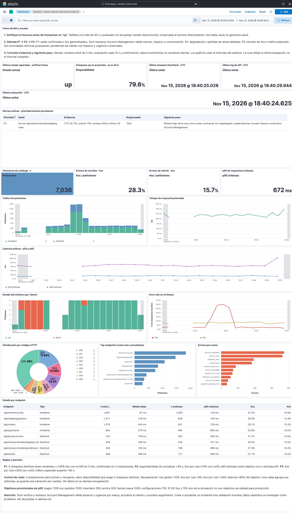

# Informe técnico de monitoreo de Bevstack Fase 3

Universidad del Valle de Guatemala · Campus Central

CC3047 Administración y Mantenimiento de Sistemas · Semestre II 2026

Catedrático: Vinicio Paz

Integrantes: Julio García Salas, Sofía García, Joaquín Campos y Carlos Valladares

Fecha de validación: 15 de noviembre de 2026

## Objetivo y alcance

El entorno permite observar la API simulada del servicio de e-commerce de Bevstack, detectar señales que requieren atención y asignar un responsable y un siguiente paso. Conserva las seis visualizaciones de la Fase 3 y añade prioridades técnicas, control de frescura y percentiles de latencia. La prioridad comercial se valida con Account Management según impacto y urgencia.

La vía elegida es la API simulada autorizada en la ampliación del enunciado. Expone un endpoint por cada elemento del catálogo de la Fase 1. El generador hace peticiones HTTP reales y la API escribe automáticamente sus logs. No representa transacciones reales de Bevstack ni modifica el Service Desk de la Fase 2.

## Arquitectura y configuración

El generador de tráfico consulta la API. La API escribe NDJSON en logs/api.log; Filebeat lee el archivo y lo envía a Elasticsearch. Heartbeat consulta /api/health cada 10 segundos. Kibana representa los logs, los chequeos y las alertas calculadas por un evaluador local de Node.js. Los contenedores se coordinan con docker-compose.yml.

| Componente | Responsabilidad |
|---|---|
| API y generador | Node.js 22. Ocho rutas del catálogo, salud y tráfico continuo de unas 5 peticiones/s por defecto. |
| Filebeat 8.19.5 | Input filestream con parser ndjson; preserva campos ECS y timestamp original. |
| Heartbeat 8.19.5 | Consulta HTTP cada 10 s; exige respuesta 200 y status up; timeout 5 s. |
| Elasticsearch y Kibana 8.19.5 | Logs en filebeat-*, chequeos en heartbeat-* y dashboard Lens. |
| Evaluador local | Consulta cada 10 s; ventana móvil de 5 min; estado y transiciones en bevstack-monitoring-current y bevstack-monitoring-events. |

## Catálogo y generación de datos

| Elemento del catálogo | Método y ruta agrupada |
|---|---|
| Activación de nueva tienda | POST /api/stores |
| Cambio de reglas de envío | PUT /api/stores/:storeId/shipping-rules |
| Configuración de productos | PATCH /api/products/:sku |
| Configuración operativa | PUT /api/stores/:storeId/operational-config |
| Pedido no procesado | POST /api/orders |
| Inventario incorrecto | GET /api/inventory/:sku |
| Pago sin creación de pedido | POST /api/payments |
| Envío no disponible | GET /api/shipping/options |

La configuración predeterminada asigna 80% de probabilidad de éxito, 15% de 4xx y 5% de 5xx. Son probabilidades por petición, por lo que una muestra finita puede variar. CLIENT_ERROR_RATE y SERVER_ERROR_RATE permiten cambiarlas. La latencia varía por endpoint y 5% de peticiones recibe un retardo de cuatro veces su base, con máximo de 3000 ms. La API espera ese tiempo antes de responder; la duración registrada se mide durante la petición.

scripts/traffic-generator.mjs ejecuta peticiones continuamente, varía parámetros y distribuye las rutas con mayor peso para inventario, envíos, pedidos y pagos. Si la API está caída registra fallos de red y sigue intentando. REQUESTS_PER_SECOND controla la frecuencia; en Compose se usa TRAFFIC_RPS.

El logger genera una línea JSON por petición con @timestamp, http.request.method, http.response.status_code, event.duration, url.path, service.name y log.level. event.duration se expresa en nanosegundos y se divide entre 1 000 000 para visualizar milisegundos. labels.route agrupa parámetros variables; labels.catalog_item y labels.catalog_type identifican el catálogo, y error.code describe el error simulado.

La muestra logs/sample-api.log contiene 500 registros generados por la API: 399 info, 77 warn y 24 error. Incluye las ocho rutas y salud, sin fabricar líneas manualmente. Los datos se conservan en volúmenes de Docker y el archivo de logs se monta desde el proyecto; la API simulada no usa Supabase.

## Lectura del dashboard

La lectura comienza por las fechas de Heartbeat, logs y evaluador. Una señal de más de 45 segundos no acredita el estado actual. La cola vacía requiere comprobar esas fechas: si el evaluador dejó de publicar, no se puede concluir que el servicio esté sano. Las fechas de Kibana se configuran en UTC.

| Visualización exigida | Interpretación |
|---|---|
| Tráfico de peticiones | Conteo de peticiones del catálogo por minuto. Incidente/Solicitud son tipos del catálogo, no cantidades de tickets. |
| Tiempo de respuesta promedio | Media de todas las respuestas en ms, conservada por el enunciado. Contrastar con p50/p95 de exitosas y detalle por ruta. |
| Estado del sistema up / down | Chequeos de Heartbeat por intervalo y último estado reportado, acompañado de su fecha. |
| Distribución por códigos HTTP | Respuestas agrupadas por código. Las peticiones de salud se excluyen de las métricas de catálogo. |
| Error rate en el tiempo | Series separadas de 4xx y 5xx, con denominador de peticiones del catálogo. |
| Top endpoints | Rutas más consultadas agrupadas por labels.route. |

Los percentiles p50 y p95 se calculan sobre respuestas exitosas 2xx/3xx para que un error rápido no mejore artificialmente la experiencia aparente. El detalle por ruta incluye n total, n exitosas, media y p95, además de 4xx y 5xx. El evaluador exige al menos 50 éxitos por ruta antes de decidir por latencia. Los percentiles de Elasticsearch son aproximados.

Los gráficos no interpolan linealmente los periodos sin datos. El porcentaje de chequeos up describe el intervalo observado; no se presenta como el SLA de atención del Service Desk. Los gráficos siguen el selector temporal, mientras las reglas evalúan siempre cinco minutos. La cola guarda la última evaluación y no reconstruye alertas históricas al cambiar el selector.

## Prioridades y reglas de atención

Las reglas se configuran en monitoring/policy.json. Son propuestas del equipo para esta simulación, no umbrales exigidos por ITIL ni acuerdos aprobados con las marcas. El evaluador espera 60 segundos al arrancar y después evalúa cada 10 segundos.

| Prioridad | Condición | Responsable y actuación |
|---|---|---|
| P1 | Dos chequeos distintos down recientes; o 5xx globales ≥30%, n≥100 en 5 min. | Tech verifica y restaura. Account Management valida alcance, marcas y comunicación. |
| P2 | Logs o Heartbeat sin actualizar >45 s; 5xx por ruta ≥10%, n≥50; p95 exitosas sobre objetivo, n exitosas≥50. | Tech revisa recolector, ruta, cambio reciente y dependencia. AM contrasta experiencia e impacto. |
| P3 | 4xx por ruta ≥30%, n≥50; o tráfico esperado ausente >60 s con logs recientes. | AM/Customer Success validan datos y demanda. Tech apoya y verifica el generador. |

Las tasas y la latencia requieren dos evaluaciones consecutivas para activar y dos para recuperar. La disponibilidad exige dos chequeos distintos tanto para caída como para recuperación. La recuperación exige 5xx globales <15%, 5xx por ruta <8%, 4xx por ruta <24% y latencia de 80% del objetivo o menos. Una muestra insuficiente conserva una alerta activa; no demuestra recuperación. Las ventanas se superponen y no son muestras independientes.

Los objetivos provisionales de p95 exitosas son: pagos 1500 ms, pedidos 1200 ms, inventario 350 ms, envíos 500 ms, tienda nueva 1000 ms y configuraciones 750 ms. Deben revisarse con una línea base y objetivos acordados con las marcas. Las proporciones de error de la simulación no son objetivos de calidad de producción.

Una caída agrupa síntomas secundarios y los 5xx globales agrupan errores por ruta. El estado interno de una alerta correlacionada se conserva; al desaparecer el padre vuelve a mostrarse si sigue activa. Se mantiene un documento actual por regla y un evento por transición visible. Antes de publicar se guarda un lote pendiente en disco. Si falla la publicación o el guardado, se reintenta ese mismo lote antes de consultar datos nuevos. El estado persistente y los identificadores estables evitan duplicar transiciones al reiniciar o reintentar.

## Validación comercial y seguimiento

Account Management confirma el impacto y la urgencia. Un bloqueo de venta o cobro con alcance amplio tiene impacto alto; una operación o marca con alcance limitado tiene impacto medio; una corrección sin interrupción de venta tiene impacto bajo. La urgencia depende de la necesidad de restaurar y de la existencia de una alternativa viable. Un código HTTP no identifica por sí solo las marcas afectadas ni los ingresos perdidos.

| Impacto / urgencia | Alta | Media | Baja |
|---|---|---|---|
| Alto | P1 | P2 | P2 |
| Medio | P2 | P2 | P3 |
| Bajo | P3 | P3 | P3 |

La matriz es una propuesta pendiente de validación por el equipo. P1 requiere atención inmediata propuesta; no se inventan plazos contractuales. Tech verifica evidencia y restaura, mientras AM coordina la comunicación. Soporte busca un incidente existente antes de crear otro y registra el inicio observado, el impacto, el responsable y la próxima actualización.

Una alerta requiere revisión; el incidente se registra o actualiza al validar una interrupción o degradación. Después de restaurar se comprueban los endpoints afectados y se valida la experiencia con AM antes de cerrar. La repetición de fallos motiva una investigación de problema y causa raíz, con responsable y acción de mejora. Los cambios no se ejecutan automáticamente desde el dashboard.

## Resultados de la validación

Se validó la ventana del 15 de noviembre de 2026 de 18:20:47 a 18:40:30 UTC. Elasticsearch almacenó 7036 peticiones del catálogo: 3936 exitosas, 1108 con 4xx y 1992 con 5xx. La media de todas las respuestas fue 236.7 ms; entre las exitosas, p50 fue 144.7 ms y p95, 671.8 ms. Heartbeat registró 82 chequeos up y 21 down. Estos resultados incluyen fallos provocados y dos frecuencias de tráfico; no describen una línea base ni un SLA de producción.

La caída de API activó una P1 a las 18:22:09 UTC y registró recuperación a las 18:25:39. Al detener Heartbeat, la pérdida de señal activó P2 a las 18:26:56 y se recuperó a las 18:28:56. Una falla aislada durante la recreación de contenedores no abrió una nueva P1 de caída.

Se aumentó temporalmente SERVER_ERROR_RATE a 0.60 y TRAFFIC_RPS a 20. Los errores generalizados activaron P1 a las 18:30:40; los errores por ruta quedaron correlacionados. Tras restaurar los valores predeterminados, la alerta global se recuperó a las 18:36:32. El historial contiene una activación y una recuperación para cada una de esas tres reglas principales.

Al cierre quedó activa P2 en reglas de envío: 7 errores 5xx en 72 peticiones de la última ventana, 9.7%. Aunque ya estaba bajo el 10% de activación, todavía no cumplía la recuperación bajo 8%. Corresponde revisar la ruta y esperar confirmación; el up del ambiente no basta para cerrar esa señal.

Se aprobaron 109 pruebas en el repositorio y pnpm build terminó correctamente. La entrega aislada incluye 56 pruebas de Fase 3, también aprobadas. Una prueba adicional reprodujo publicación exitosa con fallo de guardado local y verificó que el lote pendiente se recupere sin perder ni duplicar la transición.

Las pruebas automáticas cubren confirmación de caída, datos atrasados, muestra mínima, latencia de exitosas, histéresis, recuperación, correlación, persistencia de transiciones y errores de consulta o publicación. También comprueban las seis visualizaciones, campos, referencias y configuración de las tablas. El frontend se valida con pnpm build.

## Reproducción y límites

Extraer la entrega, abrir una terminal en la carpeta que contiene docker-compose.yml y ejecutar docker compose up -d. Se requiere Docker con memoria suficiente para Elasticsearch y Kibana y acceso a las imágenes. Abrir http://localhost:5601/app/dashboards#/view/bevstack-api-monitoring cuando Kibana y la importación estén listos. La primera corrida puede tardar por las descargas.

Para repetir la caída: docker compose stop api; esperar al menos dos chequeos down y la siguiente evaluación; revisar P1; ejecutar docker compose start api y comprobar dos up recientes. Para comprobar pérdida de señal: detener solo heartbeat, esperar más de 45 segundos y dos evaluaciones; verificar P2 y restaurar heartbeat. Los gráficos conservan el historial de estas pruebas.

docker compose down detiene los servicios y conserva los volúmenes; down -v elimina los datos y el estado. El evaluador se ejecuta como una sola instancia. Si falla la consulta o la escritura no adelanta el estado ni declara recuperación; el operador debe vigilar la fecha de evaluación. La caída completa del host o de Elasticsearch exige vigilancia externa.

La configuración es local y mantiene deshabilitada la seguridad de Elastic. No se presenta como una instalación de producción. Las alertas permanecen en Elasticsearch y Kibana; no hay notificaciones externas ni tickets automáticos. La API y el evaluador siguen separados del frontend y Supabase.

## Referencias

PeopleCert. ITIL 4 Practitioner Monitoring and Event Management. https://www.peoplecert.org/professionals/certifications/browse-certifications/it-governance-and-service-management/ITIL-1/itil4-practices-monitoring-and-event-management-3686

Google SRE. Monitoring Distributed Systems. https://sre.google/sre-book/monitoring-distributed-systems/

Elastic. Create visualizations with Lens 8.19. https://www.elastic.co/guide/en/kibana/8.19/lens.html

La aplicación combina la observación y gestión de eventos de ITIL 4 con criterios de monitoreo de SRE y las capacidades de Lens. Es una aplicación de prácticas pertinentes al alcance del curso, no una certificación de cumplimiento integral de ITIL.

## Evidencias del dashboard

Las capturas de las pruebas conservan la evaluación mostrada al pausar Kibana. Se afinó la banda de recuperación por ruta durante la validación; la política adjunta contiene los valores finales.

